<picture><source media="(prefers-color-scheme: dark)" srcset="assets/dist/hero-jobs-dark.svg"><source media="(prefers-color-scheme: light)" srcset="assets/dist/hero-jobs-light.svg"></picture>

<a href="#pick-your-list"><picture><source media="(prefers-color-scheme: dark)" srcset="assets/dist/btn-primary-dark.svg"><source media="(prefers-color-scheme: light)" srcset="assets/dist/btn-primary-light.svg"></picture></a>

<a href="https://chromewebstore.google.com/detail/gmdkffapbfeanfecgcodocfcefldjaho"><picture><source media="(prefers-color-scheme: dark)" srcset="assets/dist/btn-extension-dark.svg"><source media="(prefers-color-scheme: light)" srcset="assets/dist/btn-extension-light.svg"></picture></a>&nbsp;&nbsp;<a href="https://jobhacki.com/login-v2"><picture><source media="(prefers-color-scheme: dark)" srcset="assets/dist/btn-account-dark.svg"><source media="(prefers-color-scheme: light)" srcset="assets/dist/btn-account-light.svg"></picture></a>

Join the JobHacki Discord community to talk about jobs with other job seekers.

<table><tr><td align="center" valign="top"><h3>1.1M+</h3>full JobHacki directory, all countries</td><td align="center" valign="top"><h3>731,355</h3>default US view of the directory (US plus remote roles with no country)</td><td align="center" valign="top"><h3>12</h3>category lists below</td></tr></table>

Snapshot 2026-11-09 12:20 UTC

**Hi, I'm Sophia, JobHacki's AI assistant. Pick a list, inspect a role, and follow its employer link.**

This master list connects you to every category list, helping you explore jobs across many fields. It offers a fresh slice of jobs taken from employers' own hiring systems, last updated on Nov 9, 2026.

 

<picture><source media="(prefers-color-scheme: dark)" srcset="assets/dist/divider-dark.svg"><source media="(prefers-color-scheme: light)" srcset="assets/dist/divider-light.svg"></picture>

## Pick your list

<table><tr><td align="center" width="33%"><a href="https://github.com/Jobhacki/remote-jobs"><picture><source media="(prefers-color-scheme: dark)" srcset="assets/dist/card-remote-jobs-dark.svg"><source media="(prefers-color-scheme: light)" srcset="assets/dist/card-remote-jobs-light.svg"></picture></a></td><td align="center" width="33%"><a href="https://github.com/Jobhacki/entry-level-jobs"><picture><source media="(prefers-color-scheme: dark)" srcset="assets/dist/card-entry-level-jobs-dark.svg"><source media="(prefers-color-scheme: light)" srcset="assets/dist/card-entry-level-jobs-light.svg"></picture></a></td><td align="center" width="33%"><a href="https://github.com/Jobhacki/nursing-jobs"><picture><source media="(prefers-color-scheme: dark)" srcset="assets/dist/card-nursing-jobs-dark.svg"><source media="(prefers-color-scheme: light)" srcset="assets/dist/card-nursing-jobs-light.svg"></picture></a></td></tr><tr><td align="center" width="33%"><a href="https://github.com/Jobhacki/healthcare-jobs"><picture><source media="(prefers-color-scheme: dark)" srcset="assets/dist/card-healthcare-jobs-dark.svg"><source media="(prefers-color-scheme: light)" srcset="assets/dist/card-healthcare-jobs-light.svg"></picture></a></td><td align="center" width="33%"><a href="https://github.com/Jobhacki/tech-jobs"><picture><source media="(prefers-color-scheme: dark)" srcset="assets/dist/card-tech-jobs-dark.svg"><source media="(prefers-color-scheme: light)" srcset="assets/dist/card-tech-jobs-light.svg"></picture></a></td><td align="center" width="33%"><a href="https://github.com/Jobhacki/ai-jobs"><picture><source media="(prefers-color-scheme: dark)" srcset="assets/dist/card-ai-jobs-dark.svg"><source media="(prefers-color-scheme: light)" srcset="assets/dist/card-ai-jobs-light.svg"></picture></a></td></tr><tr><td align="center" width="33%"><a href="https://github.com/Jobhacki/sales-jobs"><picture><source media="(prefers-color-scheme: dark)" srcset="assets/dist/card-sales-jobs-dark.svg"><source media="(prefers-color-scheme: light)" srcset="assets/dist/card-sales-jobs-light.svg"></picture></a></td><td align="center" width="33%"><a href="https://github.com/Jobhacki/customer-service-jobs"><picture><source media="(prefers-color-scheme: dark)" srcset="assets/dist/card-customer-service-jobs-dark.svg"><source media="(prefers-color-scheme: light)" srcset="assets/dist/card-customer-service-jobs-light.svg"></picture></a></td><td align="center" width="33%"><a href="https://github.com/Jobhacki/internships-new-grad-2027"><picture><source media="(prefers-color-scheme: dark)" srcset="assets/dist/card-internships-new-grad-2027-dark.svg"><source media="(prefers-color-scheme: light)" srcset="assets/dist/card-internships-new-grad-2027-light.svg"></picture></a></td></tr><tr><td align="center" width="33%"><a href="https://github.com/Jobhacki/finance-accounting-jobs"><picture><source media="(prefers-color-scheme: dark)" srcset="assets/dist/card-finance-accounting-jobs-dark.svg"><source media="(prefers-color-scheme: light)" srcset="assets/dist/card-finance-accounting-jobs-light.svg"></picture></a></td><td align="center" width="33%"><a href="https://github.com/Jobhacki/marketing-jobs"><picture><source media="(prefers-color-scheme: dark)" srcset="assets/dist/card-marketing-jobs-dark.svg"><source media="(prefers-color-scheme: light)" srcset="assets/dist/card-marketing-jobs-light.svg"></picture></a></td><td align="center" width="33%"><a href="https://github.com/Jobhacki/trucking-logistics-jobs"><picture><source media="(prefers-color-scheme: dark)" srcset="assets/dist/card-trucking-logistics-jobs-dark.svg"><source media="(prefers-color-scheme: light)" srcset="assets/dist/card-trucking-logistics-jobs-light.svg"></picture></a></td></tr></table>

## Category overview

| List | Who it is for | Open jobs in latest refresh | Rows shown | Newest posting |
|---|---|---|---|---|
| [Remote jobs](https://github.com/Jobhacki/remote-jobs) | people who want to work from home or from anywhere | 49,999 | 150 | 2026-11-09 |
| [Entry-level jobs](https://github.com/Jobhacki/entry-level-jobs) | first-job seekers and career starters | 20,917 | 150 | 2026-11-09 |
| [Nursing jobs](https://github.com/Jobhacki/nursing-jobs) | nurses (RN, LPN, NP and more) | 18,382 | 150 | 2026-11-09 |
| [Healthcare jobs](https://github.com/Jobhacki/healthcare-jobs) | clinical, caregiving and medical-office job seekers | 46,957 | 150 | 2026-11-09 |
| [Tech and software jobs](https://github.com/Jobhacki/tech-jobs) | software engineers, IT and security professionals | 26,445 | 150 | 2026-11-09 |
| [AI and machine learning jobs](https://github.com/Jobhacki/ai-jobs) | ML engineers, AI researchers and applied-AI builders | 2,413 | 150 | 2026-11-09 |
| [Sales jobs](https://github.com/Jobhacki/sales-jobs) | SDRs, account executives and sales leaders | 28,540 | 150 | 2026-11-09 |
| [Customer service and support jobs](https://github.com/Jobhacki/customer-service-jobs) | support, service and customer-success pros | 9,548 | 150 | 2026-11-09 |
| [Internships and new-grad jobs](https://github.com/Jobhacki/internships-new-grad-2027) | students and recent graduates (class of 2027 and nearby) | 12,719 | 150 | 2026-11-08 |
| [Finance and accounting jobs](https://github.com/Jobhacki/finance-accounting-jobs) | accountants, analysts and finance professionals | 10,144 | 150 | 2026-11-09 |
| [Marketing jobs](https://github.com/Jobhacki/marketing-jobs) | marketers, growth and brand professionals | 9,337 | 150 | 2026-11-09 |
| [Trucking and logistics jobs](https://github.com/Jobhacki/trucking-logistics-jobs) | drivers, warehouse and logistics workers | 14,488 | 150 | 2026-11-09 |

Counts are the open jobs seen on employer hiring systems in the latest refresh, United States plus remote roles with no country set, one row per job link. A job can appear in more than one list (for example remote and entry-level).

## Explore JobHacki

<picture><source media="(prefers-color-scheme: dark)" srcset="assets/dist/explore-dark.svg"><source media="(prefers-color-scheme: light)" srcset="assets/dist/explore-light.svg"></picture>

To explore the full directory, install the free JobHacki Chrome extension and sign in with a free JobHacki account to browse all 1.1M+ listings. Choose the categories that fit your interests.

<b>How these lists are built</b>

- The lists are built from the JobHacki job board. **Last updated: 2026-11-09 12:20 UTC.** Each list shows its own freshest rows from that update.
- These GitHub lists only include jobs from public company hiring systems (ATS). They leave out hidden job boards, such as static "general apply" pages on company websites, Notion boards and others. Each list is also a short, fresh slice, not the whole directory.
- The full directory holds 1,163,796 listings across all countries (headline: **1.1M+**). 731,355 of them are in the default United States view (US listings plus remote roles with no country set); switch to all countries for the rest.

---

Source: JobHacki job directory, public employer hiring systems. © 2026 JobHacki. All rights reserved. Listings belong to their employers. See <a href="LICENSE">LICENSE</a>.

<a href="https://jobhacki.com">jobhacki.com</a> | <a href="https://chromewebstore.google.com/detail/gmdkffapbfeanfecgcodocfcefldjaho">Chrome extension</a> | <a href="https://discord.gg/RApjXmgnwA">Discord</a>
